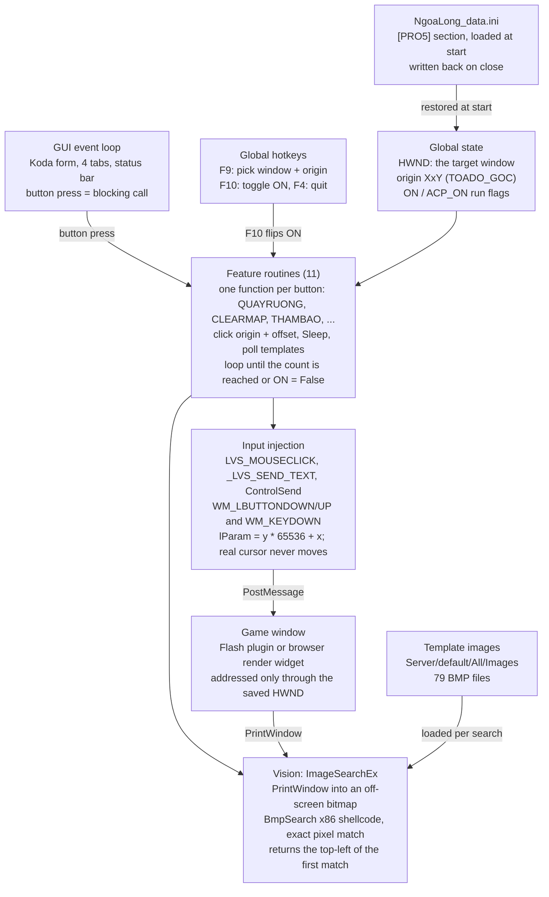

# 02 · Architecture (v1.8.0)

The components of the current app and how they connect. Index of all parts: [README.md](README.md)

v1.8.0 is one single-threaded AutoIt program. The GUI loop calls feature routines directly. Those routines reach the game in only two ways: posted window messages going out, and window screenshots coming back.

The whole app shares a handful of globals. Anything that overwrites `HWND`, which F2 and F9 both do, silently retargets every feature. The game never receives real mouse or keyboard input, which is why it can run behind other windows.

## Components

| Component | Source (in `app_logic_only.au3`, archived; see 01) | Role |
| --- | --- | --- |
| GUI event loop | Koda form section, main `While 1` / `GUIGetMsg` | Builds the 4 tabs, reads inputs, calls a feature on button press and blocks until it returns |
| Global hotkeys | `HotKeySet` block | F1 clear click list, F2 record point, F3 AutoClick on/off, F4 quit, F8 hide/show game, F9 capture origin, F10 start/stop |
| Settings | `_LOADDATA`, `GUI_EVENT_CLOSE` branch | Reads and writes `NgoaLong_data.ini` |
| Global state | `HWND`, `ON`, `ACP_ON`, `TITLEACTIVE`, origin label | Shared by every routine |
| Feature routines | `QUAYRUONG`, `MOTHEBAI`, `NANGCAPKHOAKY`, `NCCT_*`, `CAYCAPCHUACONG`, `THAPTHILUYEN`, `CLEARMAP`, `THAMBAO`, `BOSS_*`, `TRIKY`, `ACP_*` | One per button; details in [03 Workflows](03-workflows.md) |
| Input injection | `LVS_MOUSECLICK`, `_LVS_SEND_TEXT`, `ACP_BUTTON` | `PostMessage` mouse and key messages to `HWND` |
| Vision | `IMAGESEARCHEX*`, `_BMPSEARCH` | `PrintWindow` capture plus exact pixel match in embedded x86 code |
| Startup extras | `_CHECK_UPDATE`, IE `Shell.Explorer.2` banner | Blog scrape for new versions; remote ad page |
