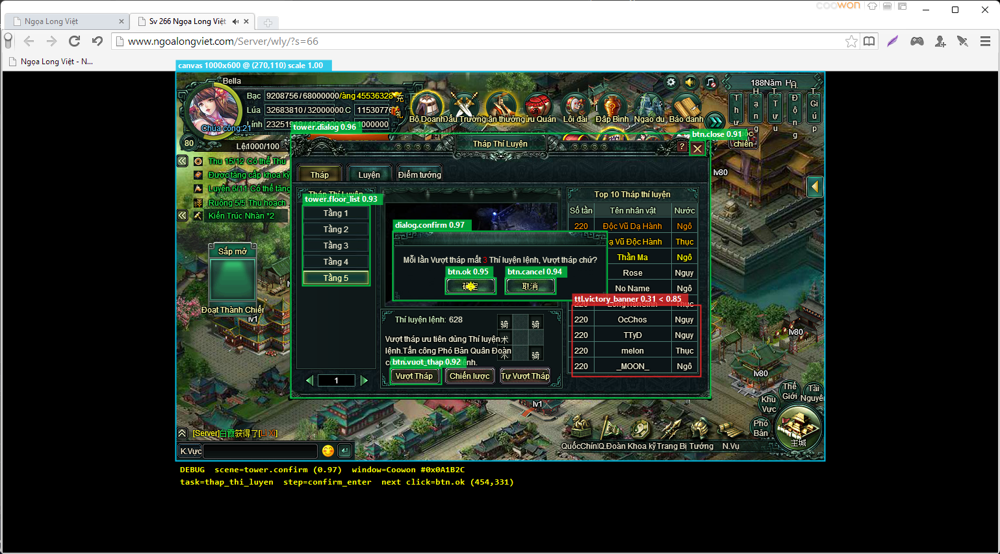

# 06 · Design

Design of AutoNgoaLong v2 in Python: target browsers, automatic screen detection, debug overlay, stack, modules, interfaces, roadmap and decisions. Index of all parts: [README.md](README.md)

The bot is built on background `PostMessage` clicks at `origin + offset`, where the origin is the game canvas's top-left corner and the offset a canvas-relative position. Around that sit a worker thread with real cancellation, OpenCV matching with a score threshold, a window binding that survives restarts, and offsets and flows stored as data instead of code.

> **Engine replaced (2026-10-08 → 10-10).** The first engine (scenes + `RunContext` + feature scripts, sections "Scene recognition" and "Pop-up guard" as first written) got lost on the live game. It was replaced by the perceive → read state → decide loop of [08](08-engine-revamp-plan.md) (phases R0–R4), and the bot now supports six features plus AutoClick. Window binding, capture, input, the canvas locator, the runner, the UI shell, routines, history, notifications and the build stay as described here; the sections below are updated to the final state.

## Target browsers

The MVP supports one host: **Coowon** on Windows. **FlashBrowser** (Windows, macOS, Linux) is out of scope for the MVP and comes after it. Both are Chromium-based, so FlashBrowser on Windows should later reuse the Win32 driver; macOS and Linux would need a driver built on the Chrome DevTools Protocol (CDP).

| Browser | Engine | Platforms | Window the bot targets | Input | Capture | Status |
| --- | --- | --- | --- | --- | --- | --- |
| Coowon | Chromium-based with built-in Flash | Windows | The top-level `Chrome_WidgetWin_1` window itself. Verified live on 2026-10-06: this Coowon build (`%LOCALAPPDATA%\Coowon\Coowon\Application\chrome.exe`) has **no** `Chrome_RenderWidgetHostHWND` child | `PostMessage` mouse and key messages to the top-level window, client coordinates | `PrintWindow` with `PW_RENDERFULLCONTENT` on the top-level window | MVP; background capture and background click both verified live |
| [FlashBrowser](https://github.com/radubirsan/FlashBrowser) | Electron 9.4.4 plus the Pepper Flash plugin you supply | Windows, macOS, Linux | Windows: the same render widget. macOS and Linux: no window handle available | Windows: `PostMessage`. Any OS: CDP `Input.dispatchMouseEvent` | Windows: `PrintWindow`. Any OS: CDP `Page.captureScreenshot` | Post-MVP; CDP path not yet tested |

What this changes in the design:

- **The origin is never 0,0.** In both browsers the game canvas sits inside a web page, so the origin is the canvas's top-left corner inside the render widget. The canvas locator finds it automatically (next section).
- **The MVP ships only the Win32 drivers.** The `InputDriver` and `Capturer` interfaces stay, so a `Cdp` driver can be added after the MVP without touching feature code.
- **CDP is post-MVP and unproven.** Pepper Flash may ignore synthetic CDP input in Electron 9 (Chromium 83). If it does, macOS and Linux fall back to OS-level input and screen capture, which needs the game window in front.
- **Page zoom changes the scale.** Chromium page zoom resizes the canvas, so `CoordMap` computes its scale factor per browser and per zoom level.
- **Post-MVP: run FlashBrowser isolated.** Its README warns that Electron 9.4.4 and Flash are end-of-life. Bind the debugging port to localhost only.

## Finding the game screen automatically

The user never sets an origin by hand. The bot finds the Coowon window, then locates the 1000×600 game canvas inside it on every capture. The 7 reference screenshots show why this is needed: the canvas's top-left corner moved between (270, 106) and (273, 112) from one capture to the next (measurements in [07 Screen catalogue](07-screen-catalogue.md)).

1. **Find the window.** Enumerate visible top-level `Chrome_WidgetWin_1` windows whose process path contains `\Coowon\` (the executable is named `chrome.exe`) and whose title contains "Ngọa Long" (for example "Sv 266 Ngọa Long Việt Nam - Coowon Browser"). Target that top-level window directly: it has no render-widget child. With several matches, list them in the UI by title; pick-under-cursor stays as a manual fallback only. The live window measured 1349×1391 client px with the canvas at about (180, 110); `tools/live/livectl.exe` is a reference implementation of find + capture + click.
2. **Locate the canvas.** Run three detectors on the capture and combine them:
    - **Anchor templates** (primary): HUD pieces with fixed canvas positions. The chat input bar "K.Vực" at the bottom-left is visible in all 7 screenshots, and the top-right gear, sound and music icons in 6. `origin = match − anchor offset`; two anchors also give the scale.
    - **Black-border box**: the page background is pure black, so the bounding box of non-black rows and columns is the canvas on bright scenes. Accept it only when its size is 1000×600 × scale, ±2 px. It found the canvas on 6 of 7 screenshots and failed on the dark tower battle (668×598).
    - **Layout prior**: the canvas is centred horizontally and top-aligned in the page. Used to place search regions, never on its own.
3. **Validate.** Accept a rectangle when two detectors agree within 3 px. Otherwise keep the last good rectangle, mark it low-confidence, and retry on the next capture.
4. **Track.** Re-run on window move or resize (WinEvent `EVENT_OBJECT_LOCATIONCHANGE`), on scene change, and every 10 s. Cache the result between runs.
5. **Scale.** `scale = canvas width / 1000`. Every position in the profile (parts, probes, number fields, navigation) is canvas-relative at 1000×600, and the perception layer works on the canvas rescaled to 1000×600, so page zoom works without re-recording.

## Screen recognition and state (replaced by 08)

*First design (P0–P3): each scene was a flat name with signature templates at fixed places (`scenes/*.yaml`, `SceneDetector`), and features waited on it with `ctx.expect_scene(...)`. Live it got lost: one template at one position named the city, a scene had no state inside it, and the bot never asked "what screen is this?" while it worked. Removed in R4.*

Now (details in [08](08-engine-revamp-plan.md)): every tick the bot captures, locates the canvas and perceives a **Snapshot**: UI parts found in search regions (templates, colour probes, the game's digit font; no OCR), the screen stack built from rules over them (a base screen, the dialogs on top, overlays), and typed readers per screen (tab, page, counts, levels, results). A feature is a goal plus rules over the Snapshot; every action carries an expectation that the next Snapshots must meet; navigation (`nav.yaml`), interrupts and a recovery ladder are built in.

## Interrupts: pop-ups and panels

The game opens reward and notice pop-ups on its own, on top of whatever a feature is doing (on 2026-10-06 a "Chúc mừng ngài được … M.C+4500" reward modal opened over a tower battle and the run waited until its time limit). The decision loop asks the interrupts (`ngoalong/engine/interrupts.py`) on every tick, before the feature's rules:

1. **Pop-ups** (`profiles/ngoalongviet/popups.yaml`): each entry has a signature template and a button, searched near where they were cut (the button region moves with the signature). A harmless one (`reward`, `toast`, the `story` box) is closed with one click, with the expectation that it is gone.
2. **Cost questions** have a `policy`: an accept and a decline button, answered by `Settings.game.<policy>` at the moment the question shows. On: accept, the run goes on. Off: decline, and the run ends as **stopped** with the entry's `stop_message`. The only one is `gold_skip_wait` ("Bỏ qua thời gian chờ tốn N Vàng. Xác nhận?", recognised by the unchanging "☐ Lần sau không nhắc nhở" line plus both buttons); setting **Cài đặt → Trong game → "Dùng vàng bỏ qua thời gian chờ"**, off by default. The bot never ticks "Lần sau không nhắc nhở". A feature that asks such a box itself (the Tinh Tú purchase) lists it in `Feature.answers`, and the guard leaves it alone.
3. **Panels** (`panels.yaml`): the quest tracker, "Sắp mở" and the chat log are collapsed on a map with no dialog, at most twice each per run (setting "Thu gọn các bảng che game khi chạy").

Only harmless pop-ups are listed without a policy. Boxes a feature answers itself (tower confirm, battle results, buy boxes) are screens the feature's rules handle.

## Debug mode and overlay

Debug mode draws what the bot sees: one rectangle per object it looked for, green if found and red if not. It is off by default. It is switched on by `debug = true` in `settings.toml`, a checkbox in the UI, or Ctrl+Alt+D.



*Illustrative mock-up, drawn on a real screenshot; scores and the window id are sample values.*

| Element | Drawn as | Label |
| --- | --- | --- |
| Game canvas | Cyan rectangle; red when low-confidence | size, origin, scale |
| Object found | Green rectangle around the match | `name score` |
| Object expected but not found | Red rectangle around the search region | `name best < threshold` |
| Planned click | Yellow crosshair | — |
| Status line | Text under the canvas | scene and score, window, task, step, next click |

How it works:

- **One data model, three outputs.** Every tick's Snapshot becomes a `DebugFrame` (`engine/actor.py` `snapshot_frame`): each UI part found as a `Detection` (name, rectangle, score), the ✕ no screen claimed in red, the screen stack as the status line, planned clicks. The overlay is a by-product of normal detection, not separate code. Three sinks render the same `DebugFrame`:
    1. **Live overlay window**: a frameless, transparent, click-through, top-most Qt window (`WS_EX_LAYERED | WS_EX_TRANSPARENT | WS_EX_NOACTIVATE | WS_EX_TOOLWINDOW`) kept on top of the render widget's screen rectangle. Visible only while the game is on screen; the bot itself keeps working in the background.
    2. **Debug panel** in the app: the last capture with the same annotations, so debugging works while the game is behind other windows.
    3. **Annotated PNGs**: in debug mode every step is saved to `logs/run-<id>/NNN-<step>.png`. On any failure the last frame is always saved, debug mode or not.
- **Offline checking.** `python tools/perceive.py <png or folder> --draw DIR` prints and draws the Snapshot of stored canvas captures; `--live` does it on the game window; `--bench` runs the perception benchmark over the labelled corpus (`corpus/live/labels.yaml`). `--selftest` runs the same benchmark on the 57 frames bundled into the build. There is no unit-test suite (removed in R0 by choice).
- **No cost when off.** With debug mode off, detections are still recorded (they are cheap) but nothing is drawn or saved except failure frames.

## Stack

| Concern | Choice | Why |
| --- | --- | --- |
| Runtime | Python 3.12, 64-bit; Windows only for the MVP | The MVP targets Coowon, which is Windows-only, and the proven PostMessage path is Win32. |
| Win32 access | `pywin32`, plus `ctypes` for `PrintWindow` and `RegisterHotKey` | Direct access to the Win32 calls the bot needs: window enumeration, messages, capture, hotkeys |
| CDP (FlashBrowser, post-MVP) | A small raw DevTools Protocol client on websocket-client. FlashBrowser is launched with --remote-debugging-port bound to localhost. | Background input and screenshots on all three operating systems, if Pepper Flash accepts CDP input (post-MVP spike) |
| Capture | `PrintWindow(hwnd, PW_RENDERFULLCONTENT)` into a NumPy array | Works when the window is covered, and handles Chromium surfaces. DCs are freed in `finally` blocks, so long runs do not leak GDI handles. |
| Vision | OpenCV `matchTemplate` (`TM_CCOEFF_NORMED`), per-template threshold, region of interest and mask, templates cached in memory | Tolerates colour drift. Returns the centre and a score. |
| Debug overlay | Qt transparent click-through window for live view; OpenCV `rectangle`/`putText` for the panel and saved PNGs | Same `DebugFrame` drawn three ways; no extra dependency |
| UI | PySide6 (Qt 6), Vietnamese UI only | Threaded runs with signals for log, progress and state, so the UI stays responsive. |
| Config | `pydantic` models saved as TOML (user settings); YAML for offsets and flows | Validated inputs, readable files, and versioned profiles |
| Hotkeys | `RegisterHotKey` on a message thread, configurable, with a modifier by default (Ctrl+Alt+F10 = stop) | Global hotkeys with a modifier do not take plain F-keys from other apps |
| Packaging | PyInstaller one-folder build, later Nuitka | Simple distribution. The templates folder stays editable. |
| Quality | A labelled corpus of live canvas captures and the perception benchmark (`tools/perceive.py --bench`, `--selftest` in the build); live gates per phase | Perception is checked frame by frame without the game; flows are checked on the live game |

## Module layout

As built (2026-10-10, after R4). The bot structure page ([bot-structure.html](bot-structure.html)) draws it.

```text
ngoalong/
  app.py                 # entry point, AppServices (DI wiring, one Actor per run), command line
  paths.py  selftest.py  hotkeys.py  notify.py
  config/settings.py     # pydantic settings (settings.toml), removed features forgotten
  core/
    window.py            # GameWindow: discover Coowon windows, bind by pid/exe/class/title, rebind
    locator.py           # CanvasLocator: anchors + black-border box + layout prior -> canvas rect, scale, confidence
    capture.py  input.py # Capturer / InputDriver interfaces, frame cache, VK codes
    drivers/             # win32.py (PostMessage + PrintWindow), fake.py (recording input), cdp.py (stub)
    templates.py vision.py  # TemplateStore, Matcher / score maps (OpenCV)
    digits.py            # the game's digit font reader (no OCR)
    geometry.py errors.py cancel.py detection.py _winapi.py
  perception/            # canvas -> Snapshot (docs/08 "Perception")
    parts.py probes.py screens.py readers.py snapshot.py
    bench.py             # the perception benchmark (tools/perceive.py --bench, --selftest)
  engine/
    task.py feature.py   # Task (Params, run(actor)); Feature = entry + Memory + rules + goal
    loop.py actions.py   # the decision loop; Click / Burst / Key / Text / Wait / Done / Fail / Navigate
    navigate.py interrupts.py recovery.py actor.py
    runner.py control.py # TaskRunner (QThread), execute(), Stop / Pause
    registry.py manager.py scheduler.py history.py
  features/              # quay_ruong, thap_thi_luyen, cong_trinh, khoa_ky, clear_map, vo_khoi_thap, autoclick
  debug/                 # DebugFrame model, renderer, overlay window, sinks (overlay, panel, PNG)
  tools/                 # explore.py (capture + click for the corpus), run_feature.py (one feature from the console)
  ui/                    # main window, feature page + generated forms, tabs/, widgets/
profiles/ngoalongviet/
  parts.yaml probes.yaml numbers.yaml screens/*.yaml   # perception
  nav.yaml popups.yaml panels.yaml locator.yaml        # navigation, interrupts, canvas anchors
  part_crops.yaml template_crops.yaml digit_samples.yaml  # reproducible template cuts
  templates/**           # part/, digits/game/, anchor/, popup/, overlay/, hud/, field/
tools/                   # perceive.py, part_report.py, number_report.py, cut_templates.py, cut_digits.py
corpus/live/             # labelled live captures (labels.yaml in git, PNGs local only)
```

## Core interfaces

```python
class GameWindow:
    @classmethod
    def discover(cls) -> list["GameWindow"]: ...  # Coowon windows whose title contains "Ngọa Long"
    def rebind(self) -> bool: ...                 # find again by pid/exe/class/title

class CanvasLocator:                               # canvas origin and scale, found on every capture
    def locate(self, frame: np.ndarray) -> CanvasFix: ...   # rect, scale, confidence, detectors that agreed

class Perceiver:                                   # perception/snapshot.py
    def perceive(self, canvas: np.ndarray) -> Snapshot: ... # base, dialogs (top last), overlays, unknown, hud
# snap.top, snap.has("tower.dialog"), snap["tower.dialog"].page, snap.value("chest.wheel", "chests")

class Feature(Task):                               # engine/feature.py
    entry: str                                     # the loop navigates here when no rule applies
    class Memory(BaseModel): ...
    def rules(self) -> list[Rule]: ...             # Rule(name, on=screen, when=..., do=... -> Action)
    def goal(self, snap: Snapshot) -> str | None: ...

# engine/actions.py: every action that touches the game says what it expects next
Click(at, expect="confirm.ok_cancel", within=3) | Burst(points, times, interval) | Key(vk)
Text("200", at=box, expect=lambda n: n.value("chest.buy", "qty") == 200) | Wait(s) | Done(msg) | Fail(msg) | Navigate(screen)

class Actor:                                       # engine/actor.py: one per run, built by AppServices
    def look(self) -> tuple[np.ndarray, CanvasFix]: ...
    def click(self, p: Point, double=False, button="left") -> None: ...   # canvas point; mouse rests at (600, 2)
    def burst(self, points, times, interval) -> None: ...
    def type_into(self, text, at, clear, enter) -> None: ...
    def log(self, message, level="info") -> None: ...; def progress(self, done, total) -> None: ...
    def count(self, name, n=1) -> int: ...         # run-history counters

class InputDriver(Protocol):                       # Win32InputDriver | CdpInputDriver (stub)
    def click(self, p: Point, button: str = "left", double: bool = False) -> None: ...
    def key(self, vk: int) -> None: ...            # key down + key up
    def text(self, s: str) -> None: ...           # digits as key presses, other characters as WM_CHAR

class Capturer(Protocol):                          # Win32Capturer
    def grab(self) -> np.ndarray: ...             # BGR frame of the client area (PrintWindow)
```

Each feature is a `Task` subclass with a pydantic `Params` model, so the UI form, validation and saved settings all come from one definition.

## Roadmap

Build in five phases. Each phase ends at a gate that must be checked against the real game before the next one starts, so the foundations and the core features (P0–P2) are done before new features (P3).

| Phase | Scope | Exit gate |
| --- | --- | --- |
| **P0 · Foundations (start here)** | GameWindow discovery, CanvasLocator, SceneDetector (7 known scenes), InputDriver, Capturer, Matcher, debug overlay + annotate tool, TaskRunner, settings. First working tasks: AutoClick and Quay rương on Coowon (Windows). | Canvas found within 2 px and scene named correctly on all 7 reference screenshots; 1-hour soak with a flat GDI-handle count; Stop ends any run within 1 s |
| P1 · Offset-only features | Mở thẻ bài, Khoa kỹ, Công trình, Chúa công, Quay rương, Tháp Thí Luyện. Offsets loaded from coords.yaml, with a zoom scale factor. | Each feature checked on the live game, feature by feature |
| P2 · Template-driven features | Clear Phó Bản, Thám Bảo, Võ Khôi Tháp, Tri Kỷ. Templates captured on ngoalongviet.com, thresholds tuned, every wait time-limited. | Each runs 30 minutes with no stuck loop; every miss logged with a screenshot |
| P3 · New features | Scheduler and routine chains, multiple windows, template capture tool, notifications, run history, FlashBrowser | Beta testers run their daily routines for one week |
| P4 · Release | PyInstaller build and installer, update check through GitHub Releases, user guide in Vietnamese | — |

P0 builds the parts every feature depends on (window, capture, input, matching, stop), so every later phase is built on foundations already checked live.

## Implementation status (2026-10-10)

P0–P4 were built on the first engine (2026-10-06) with an offline pytest suite. The suite and the scene definitions were removed on 2026-10-08 (R0) and the engine was replaced phase by phase (R1–R4, [08](08-engine-revamp-plan.md)); the table keeps what each phase built, with what the revamp changed.

| Phase | Built | Where |
| --- | --- | --- |
| P0 · Foundations | Coowon window discovery and rebinding (top-level `Chrome_WidgetWin_1`), Win32 `PostMessage` input and `PrintWindow` capture with DCs freed in `finally`, `CanvasLocator` (anchors + black border + layout prior), `SceneDetector` (35 scenes, all golden screenshots pass), `Matcher`, `CoordMap`, debug model + overlay window + panel + PNG sink, annotate tool, `TaskRunner` with stop/pause, settings, configurable hotkeys (Ctrl+Alt+F10 stop, Ctrl+Alt+D debug), Vietnamese Qt UI with forms generated from `Params`. Features: AutoClick, Quay rương | `ngoalong/core`, `debug`, `engine`, `ui`, `config`, `hotkeys.py`, `tools/annotate.py` |
| P1 · Offset-only features | Mở thẻ bài, Nâng cấp khoa kỹ, Nâng cấp công trình, Cày cấp chúa công, Tháp Thí Luyện (shared tower steps), each checking its screen before clicking | `ngoalong/features/*.py`, `profiles/ngoalongviet/coords/*.yaml` |
| P2 · Template-driven features | Clear Phó Bản, Thám Bảo, Võ Khôi Tháp, Tri Kỷ; templates cut reproducibly (`template_crops.yaml`, `tools/cut_templates.py`), every wait time-limited | `ngoalong/features`, `profiles/ngoalongviet/scenes`, `templates` |
| P3 · New features | Routine chains + scheduler, multiple windows, template capture tool, notifications (tray, Telegram, Discord), run history, Thám Bảo x2 reward | `engine/scheduler.py`, `engine/manager.py`, `engine/history.py`, `notify.py`, `tools/template_tool.py`, `ui/tabs/*` |
| P4 · Release | PyInstaller one-folder build (`AutoNgoaLong.spec`, `build.ps1`) with `profiles/` next to the exe; `--selftest` (exit code 0/1); app paths for source and build (`ngoalong/paths.py`); Vietnamese user guide; developer README | `AutoNgoaLong.spec`, `build.ps1`, `ngoalong/selftest.py`, `README.md` (user guide), `development-guide.md` |
| R0–R4 · Engine revamp ([08](08-engine-revamp-plan.md)) | Live corpus (569 labelled frames, 539 of them in scope); perception without OCR (69 parts, 19 probes, 15 number fields, 35 screens); decision loop with expectations, navigation, interrupts, recovery; the six supported features ported and run live; out-of-scope features, scenes, `RunContext`, coords, OCR, the template tool and 112 templates removed; `--selftest` runs the perception benchmark on 57 bundled frames; `build.ps1` without pytest | `ngoalong/perception`, `ngoalong/engine`, `ngoalong/features`, `profiles/ngoalongviet` |

Changed by the revamp: P0's `SceneDetector`, `CoordMap` and `RunContext` are gone (perception, the loop and the `Actor` replace them); P1–P2's features are rewritten as rule sets, and Mở thẻ bài, Cày cấp chúa công, Thám Bảo and Tri Kỷ are removed (with Chạy Thành Tựu, added later); P3's template capture tool ("Mẫu ảnh" tab) and the Thám Bảo x2 reward are removed.

Deferred or still open:

- **FlashBrowser / CDP**: only the empty `CdpInputDriver` / `CdpCapturer` stub (`core/drivers/cdp.py`); no `profiles/browsers.yaml`; macOS and Linux unsupported.
- **P4 leftovers**: no installer (distribute the zipped `dist\AutoNgoaLong\` folder), no GitHub Releases update check, no code signing (SmartScreen warns), Nuitka not tried.
- **Live gates**: the revamp's live gates (R2 pilots 30 min, R3 per feature) are in 08; the account ran out of upgradeable work for structures, Khoa kỹ and the campaign, so those were shorter.
- **OCR**: RapidOCR was added on 2026-10-06 for Chạy Thành Tựu and removed in R4 with it. Nothing reads text: numbers use the game's digit font (`core/digits.py`). If OCR is ever needed again, it must stay cross-platform (RapidOCR, not Windows.Media.Ocr) and outside screen identification (08 "When OCR is allowed").
- **Later ideas**: template profiles per server or website.

## New features beyond the core set

- [x] **Routine chains and scheduler**: run a saved sequence such as Khoa kỹ → Công trình → Trial Tower → Boss at set times, with retries. (P3: "Chuỗi tác vụ" tab, `engine/scheduler.py`.)
- [x] **Multiple windows**: one `TaskRunner` per bound game window, so several accounts run in parallel. The target server allows bots. (P3: "Nhiều cửa sổ" tab, `engine/manager.py`.)
- [ ] **Template profiles per server or website**: a selector for which server's or website's templates to use.
- [ ] ~~**Template capture tool**~~: built in P3 ("Mẫu ảnh" tab), removed in R4 with the scenes it wrote to. Templates are now cut reproducibly from `part_crops.yaml` / `template_crops.yaml` (`tools/cut_templates.py`), frames captured with `python -m ngoalong.tools.explore`.
- [x] **Notifications**: tray alerts plus optional Telegram or Discord messages on finish, stop or error, including a screenshot. (P3: "Thông báo" tab, `notify.py`.)
- [x] **Run history**: logs, counters (spins, floors, bosses), and failure screenshots saved per run. (P3: "Lịch sử" tab, `engine/history.py`.)
- [ ] ~~**Thám Bảo x2 reward**~~: built in P3, removed in R4 with Thám Bảo (out of scope).
- [x] **Resource-aware runs**: silver, Quân lệnh, chests, Thí luyện lệnh, levels and costs are read every tick with the digit reader (no OCR); Võ Khôi Tháp buys silver chests before the 2-billion cap and refills Quân lệnh from Tinh Tú chests.
- [ ] **FlashBrowser support**: Windows first through the existing Win32 driver, then macOS and Linux through a CDP driver once a spike shows Pepper Flash accepts CDP input.

## Decisions (2026-10-06)

- **Platform:** Windows only for the MVP, on Coowon. FlashBrowser, macOS and Linux are out of scope for the MVP.
- **Server:** ngoalongviet.com, game page `http://www.ngoalongviet.com/UserCenter/mjwly.php`. Its templates still need capturing, before P2 starts.
- **UI language:** Vietnamese only.
- **Licence:** MIT (`LICENSE` in the repository root).
- **Bot policy:** the target is a private server of a legacy Flash game that allows bots, so multi-account features are acceptable.

No open questions remain.
